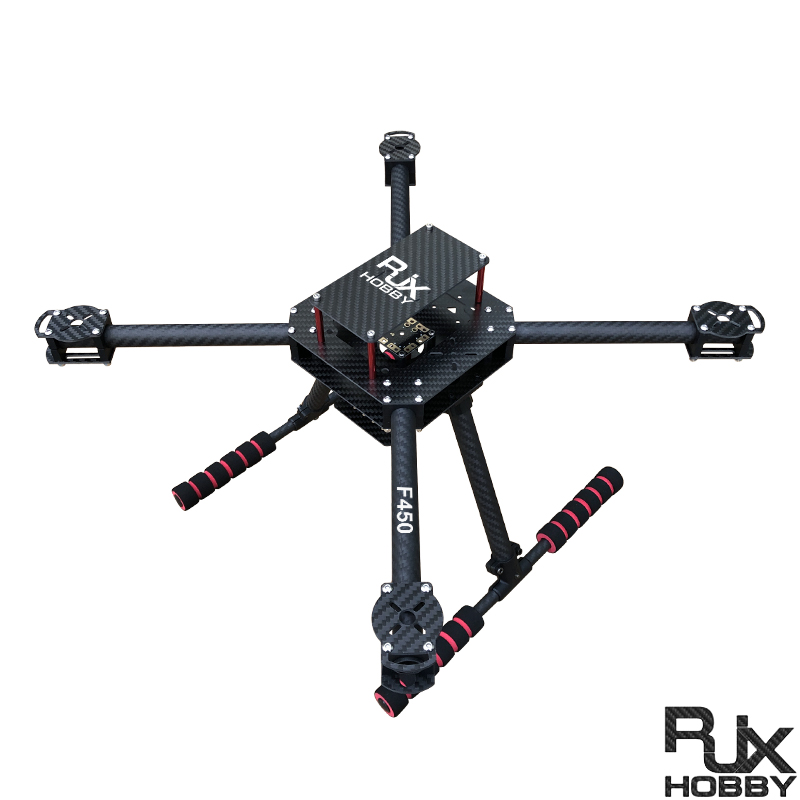
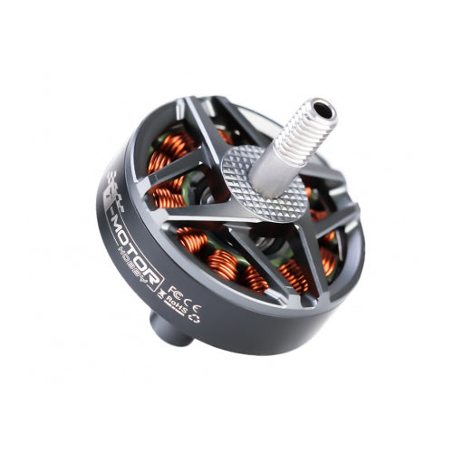
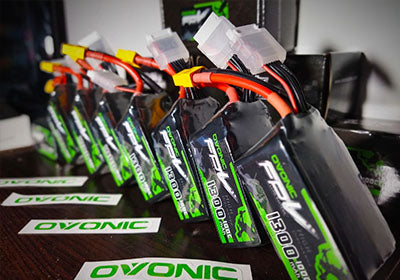
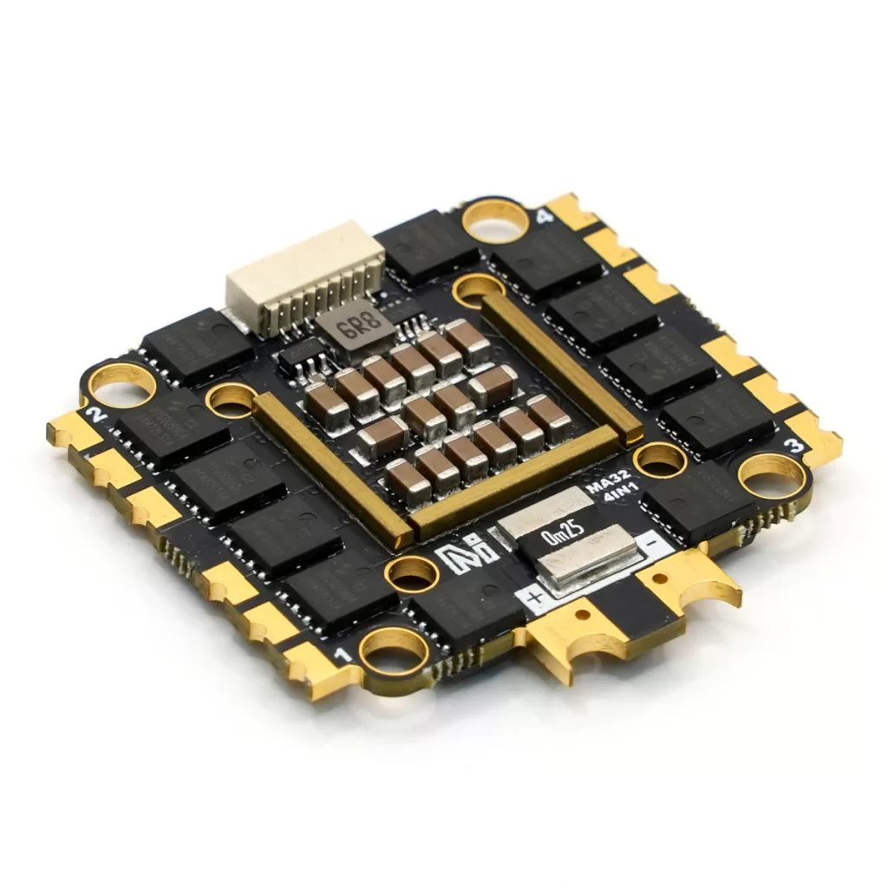
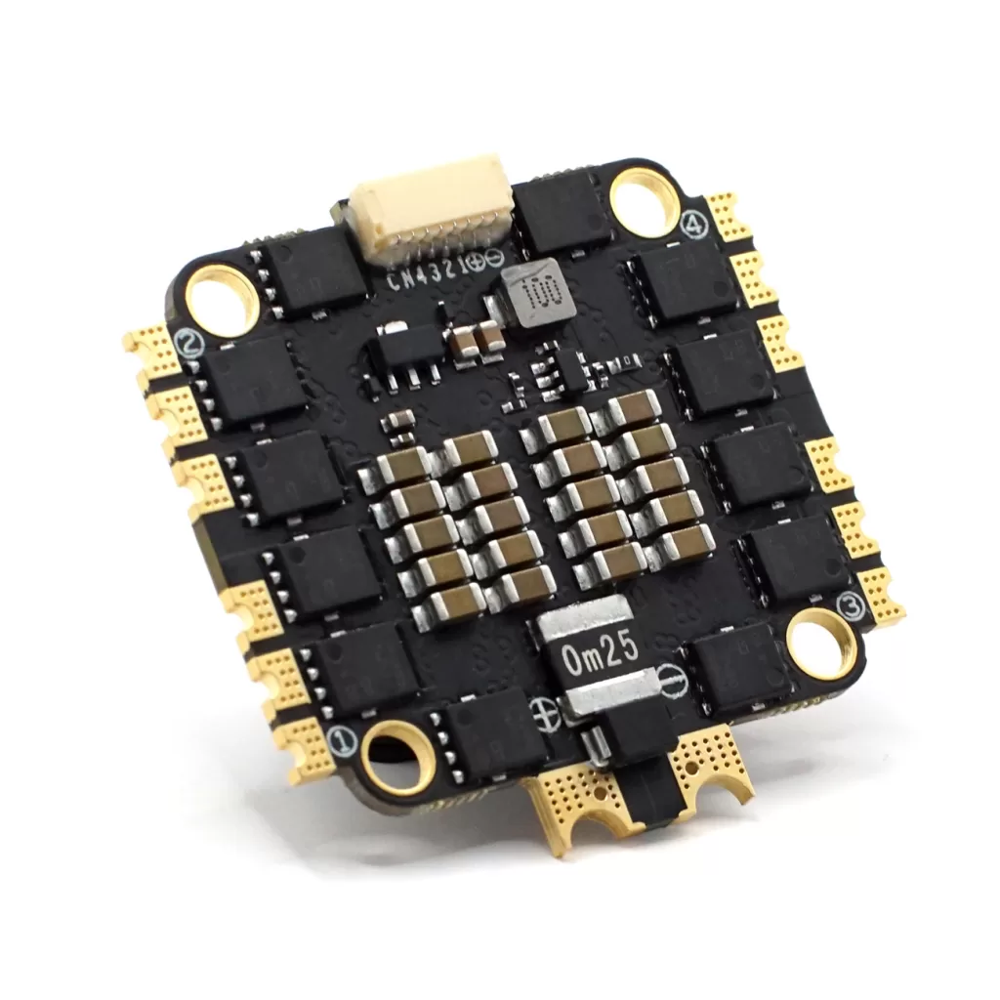
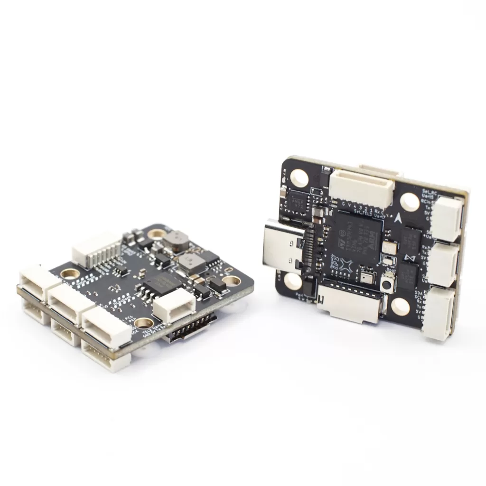
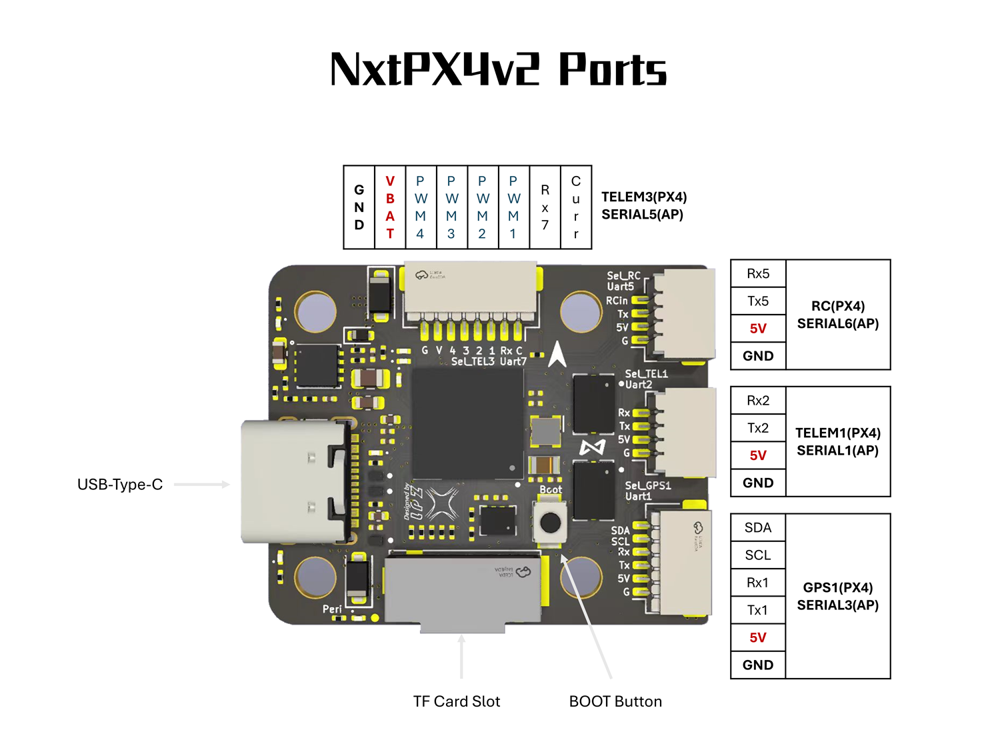
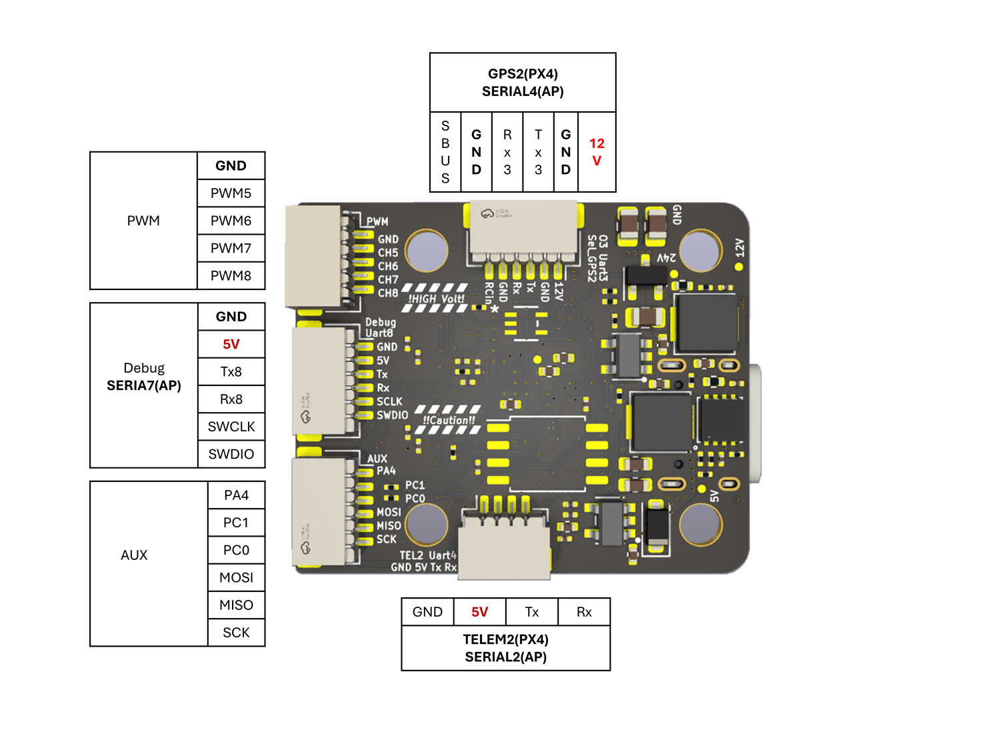
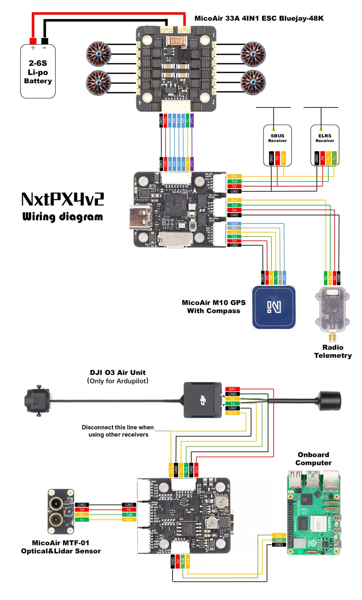
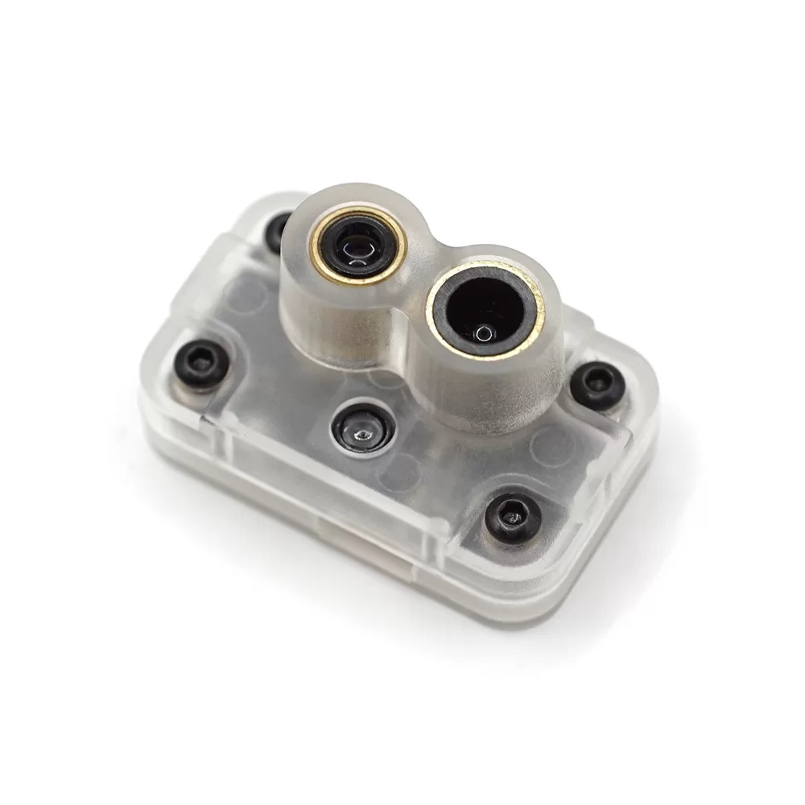

# Plataforma — hardware, firmware y comunicaciones

Ficha técnica completa del dron: qué hay montado, qué firmware corre y cómo se comunica todo.

**Última verificación contra el FC:** 2026-09-07 · Volcado: [`backups/backup_fc_2026-09-07.params`](../backups/backup_fc_2026-09-07.params)

> Esta plataforma **replica la del proyecto SUPER** (HKU MaRS Lab) como base para desarrollar
> mejoras encima. La comparación con su BOM original y las diferencias deliberadas están
> en la [§7](#7-referencia-super-hku-mars-lab).

---

## 1. Airframe y propulsión

<table>
<tr>
<td width="33%"><br><sub><b>Frame</b> RJX F450 carbono</sub></td>
<td width="33%"><br><sub><b>Motor</b> T-Motor F90 2806.5 1300KV</sub></td>
<td width="33%"><br><sub><b>Batería</b> Ovonic 6S 1300 mAh 100C</sub></td>
</tr>
</table>


| Componente | Modelo | Especificación clave |
|---|---|---|
| Frame | **RJX F450**, fibra de carbono | Wheelbase **450 mm** (diagonal entre motores opuestos) · [ficha](https://www.rjxhobby.com/rjx-f450-carbon-fiber-frame-kit) |
| Configuración | Quad-X | `SYS_AUTOSTART=4001`, `CA_AIRFRAME=0` |
| Motores (4×) | **T-Motor F90 2806.5 · 1300 KV** | 33.4 × 34.7 mm · eje 4 mm · **46.6 g** · 5-6S · pico **45.1 A / 1059 W** · **2360 g de empuje** al 100% con hélice 7×4 · [ficha](https://www.t-hobby.com/products/brushless-motor-x8-fpv-drones-f90-2806-5) |
| Hélices (4×) | **HQProp 7×4×3** (7040), tripala | 7" |
| ESC | **MicoAir Bluejay-4IN1-60A** | 60 A × 4 · 3-6S · firmware **Bluejay 0.19.2** (BLHeli_S) · 44 × 43.5 × 5.2 mm · 13.5 g · montaje 30.5×30.5 (Φ4) · [ficha](https://micoair.com/esc/) |
| Batería | **Ovonic 6S1P 1300 mAh 100C** | 22.2 V · **222 g** · 74 × 44 × 34 mm · XT60 · 130 A continuos / 260 A pico · [ficha](https://www.ampow.com/products/ovonic-100c-1300mah-6s1p-22-2v-xt60-4pcs-lipo-battery) |
| Protocolo de motor | DShot 600 bidireccional | `PWM_MAIN_TIM0=-3`, `DSHOT_MIN=0.055`, `DSHOT_BIDIR_EN=1` |
| Mapeo de salidas | `PWM_MAIN_FUNC1..4 = 101, 104, 103, 102` | ⚠️ corregido 2026-10-27 (ver abajo) |

**Empuje de hover medido en vuelo real:** 0.284 (media) / 0.287 (mediana), p10-p90 0.270-0.295
→ `MPC_THR_HOVER=0.30`. El grupo propulsor da **9.4 kg de empuje total**, muy sobrado para un
F450 — margen pensado para cargar el MID360 y el ordenador a bordo.

### ⚠️ Dos cosas a revisar

**~~La geometría del mixer no cuadra con el frame.~~ ✅ Corregido (2026-09-07).** Un F450 tiene
450 mm de diagonal, así que cada rotor va a **±0.159 m** en X e Y (225/√2). Estaba en ±0.17 (y en
el FC#1, ±0.15). Ya actualizado a **±0.159** en los cuatro rotores, con los opuestos en negativo.
QGC muestra `0.16` por redondeo a dos decimales; el valor guardado es 0.159.

### Mapeo de motores — geometría vs. salidas (⚠️ corregido 2026-10-27)

Hay **dos capas** y conviene no confundirlas:

1. **Geometría (`CA_ROTOR*`)** — define los 4 rotores lógicos (Motor 1-4 en QGC) con su
   posición y sentido de giro. Es el Quad-X estándar y **no se toca**:

   | Motor (QGC) | `CA_ROTOR` | PX | PY | `KM` | Giro | Posición física |
   |---|---|---|---|---|---|---|
   | Motor 1 | ROTOR0 | +0.159 | +0.159 | +0.05 | **CCW** | delantero-derecha |
   | Motor 2 | ROTOR1 | −0.159 | −0.159 | +0.05 | **CCW** | trasero-izquierda |
   | Motor 3 | ROTOR2 | +0.159 | −0.159 | −0.05 | **CW**  | delantero-izquierda |
   | Motor 4 | ROTOR3 | −0.159 | +0.159 | −0.05 | **CW**  | trasero-derecha |

   (Ejes PX4 **FRD**: +X al morro, +Y a la derecha. `KM` positivo = CCW, negativo = CW.)

2. **Salidas (`PWM_MAIN_FUNC1..4`)** — a qué pin físico del ESC (MAIN 1-4) va cada motor
   lógico. **Esta es la capa que compensa el cableado**:

   | Salida ESC | Función | Motor lógico |
   |---|---|---|
   | MAIN 1 | 101 | Motor 1 |
   | MAIN 2 | 104 | Motor 4 |
   | MAIN 3 | **103** | **Motor 3** |
   | MAIN 4 | **102** | **Motor 2** |

**El arreglo (2026-10-27):** el cableado entre el **motor 2 y el motor 3** estaba cruzado, así
que el mapeo previo (`FUNC3=102`, `FUNC4=103`) mandaba cada señal al motor equivocado. Se
intercambiaron **`PWM_MAIN_FUNC3` ↔ `PWM_MAIN_FUNC4`** (quedan `103` y `102`) para que cada
salida accione el motor físico correcto. La geometría `CA_ROTOR*` no cambió. Verificado con
*Identify & Assign Motors* de QGC (hélices quitadas) — cada motor responde donde debe y en el
sentido correcto.

> ⚠️ **Restore point:** los backups de params **anteriores al 2026-10-27** llevan el mapeo viejo
> (`FUNC3=102`, `FUNC4=103`). Recargar uno de ellos **vuelve a cruzar motor 2↔3** → hay que
> re-aplicar `PWM_MAIN_FUNC3=103` y `PWM_MAIN_FUNC4=102` después. Usar el backup
> `*_2026-10-27_*` como referencia correcta.

**Autonomía muy corta.** 1300 mAh es **2.5× menos** que los 3300 mAh de la BOM de SUPER. Con
estos motores en hover el consumo estará en el entorno de 20-30 A, lo que deja del orden de
**3-4 minutos de vuelo** — estimación gruesa, hay que medirla con el log de `battery_status`.
Suficiente para pruebas indoor cortas; escaso para el trabajo de navegación de SUPER.

**Calibración de batería (2026-10-27).** Con la LiPo de vuelo (6S 1300 100C) y **25.0 V medidos**
con voltímetro, el FC leía 24.70 V → se recalibró `BAT1_V_DIV` 9.9131 → **10.0315** (ahora lee
~24.9 V, <0.5%). ⚠️ **La corriente NO está calibrada**: el FC marca ~13.6 A con el dron parado y
hélices quitadas (imposible) → `BAT1_A_PER_V=17` es el valor por defecto / el canal de corriente
no da una lectura válida.

**Síntoma y corrección del % (2026-10-27, 2ª revisión).** QGC marcaba la batería "descargándose
rápido" y llegaba a **0% con 24.1 V reales medidos** (= 4.0 V/celda ≈ 75-80% de carga). Causa: el %
de PX4 se calcula por **conteo de culombios** (integra la corriente sobre `BAT1_CAPACITY=1300 mAh`),
y con `A_PER_V=17` sobreestimando la corriente (~13.6 A en reposo) el estimador "consume" los
1300 mAh en pocos minutos → 0% falso, mientras el voltaje real seguía alto. **Corrección aplicada:**
`BAT1_CAPACITY = -1` → desactiva el conteo de culombios, el **% se estima por voltaje** (`N_CELLS=6`,
`V_EMPTY=3.5`, `V_CHARGED=4.2` ya correctos; a 24.1 V ≈ 74% en reposo). El % por voltaje baja bajo
carga (sag) y se recupera en reposo, es lo normal. Backup previo:
`backups/backup_fc_2026-10-27_bat-pre-capfix.params`.

Sigue vigente: no usar `COM_LOW_BAT_ACT` por % como criterio fino; gestionar **por voltaje de celda**
(aterrizar ~3.6 V/celda ≈ 21.6 V). Fix definitivo del fuel-gauge por mAh: calibrar `A_PER_V` en banco
(hélices quitadas, gas fijo, amperios reales con pinza/vatímetro) y entonces re-habilitar
`BAT1_CAPACITY=1300`.

⚠️ Los ESC generan el **beacon** haciendo sonar los propios motores (no llevan buzzer): energizan
las bobinas a frecuencia audible sin conmutar, y el estátor vibra. Tras ~10 min inactivo empieza
a pitar. No se puede desactivar desde PX4 — no hay passthrough BLHeli ni comando DShot de beacon.

### ESC — familia MicoAir 4-en-1

<table>
<tr>
<td width="50%"><br><sub><b>AM32-4IN1-55A</b></sub></td>
<td width="50%"><br><sub><b>Bluejay-4IN1-60A</b></sub></td>
</tr>
</table>


Los tres modelos que vende el fabricante del FC. Todos soportan **DShot300/600** y sacan
**12.75 mV/A** de sensor de corriente.

| Modelo | Corriente | Celdas | Firmware | Tamaño | Peso | Montaje |
|---|---|---|---|---|---|---|
| AM32-4IN1-55A | 55 A × 4 | 2-6S | AM32 `F4A_4IN1_F421_2.17` | 44 × 43.5 × 5.2 mm | 14 g | 20×20 (Φ3) o 30.5×30.5 (Φ4) |
| ✅ **Bluejay-4IN1-60A** | **60 A × 4** | **3-6S** | **Bluejay 0.19.2** (BLHeli_S) | **44 × 43.5 × 5.2 mm** | **13.5 g** | **30.5×30.5 (Φ4)** |
| **Bluejay-4IN1-33A** | 33 A × 4 | 2-6S | **Bluejay** 0.19.2 (BLHeli_S) | 29 × 31 × 5.3 mm | 5 g | 20×20 (Φ3) |

**El montado es el Bluejay-4IN1-60A.** Los 60 A por canal cubren con margen los **45.1 A de pico**
que pide cada motor.

💡 **Para subir el beacon delay:** al ser **Bluejay** (derivado de BLHeli_S), el configurador es
**BLHeli Configurator** (o el Bluejay Configurator), donde están *Beacon Delay* (1/2/5/10 min o
infinito) y *Beacon Strength*.

Hay que llegar al ESC **por la línea de señal**: linker USB directo a los pads, o una placa
Betaflight haciendo de puente 4-way. **PX4 no tiene passthrough** — verificado en el fuente de la
1.14.3.

---

## 2. Controlador de vuelo

Dos unidades del **mismo modelo**, con firmware distinto. No confundirlas.

| | **FC#1** | **FC#2** (en uso) |
|---|---|---|
| Modelo | HKUST **NxtPX4v2** | HKUST **NxtPX4v2** |
| Board ID | 1013 | 1013 |
| Firmware | PX4 **1.17.0** (build custom) | PX4 **1.14.3** de fábrica |
| Uso | primer dron | **segundo dron, plataforma actual** |



### Especificaciones ([ficha del fabricante](https://micoair.com/flightcontroller_nxtpx4v2/))

| | |
|---|---|
| MCU | **STM32H743VIH6** @ 480 MHz, 2 MB Flash |
| Encapsulado | **TFBGA100, 8.0 × 8.0 × 1.10 mm**, pitch 0.8 mm, sin pad térmico expuesto |
| IMU | **2× BMI088** |
| Barómetro | **SPL06** |
| Almacenamiento | ranura microSD |
| Puertos serie | **7 UART** (GPS, telemetría, RC, telemetría de ESC) |
| Otros buses | 1× I2C (brújula externa) · 1× SPI · SWD · USB-C |
| Salidas de motor | **8 PWM** con soporte DShot |
| BEC | **5 V / 2.5 A** y **12 V / 2.5 A** |
| Medida de batería | sensor de tensión interno + entrada de corriente externa (2 canales ADC) |
| RC | SBUS y CRSF por UART dedicada |
| Dimensiones | **27 × 32 × 8 mm** · **6.5 g** |
| Montaje | 20 × 20 mm, agujeros Φ3 mm |
| Flash utilizable | 1792 KiB · bootloader **rev 5** |

El repo de hardware ([Peize-Liu/Nxt-FC-Hardware](https://github.com/Peize-Liu/Nxt-FC-Hardware))
indica 27 × 29 × 8 mm — pequeña discrepancia entre revisiones.

💡 El **BEC de 12 V / 2.5 A** es el que alimentará el Livox MID360 (9-27 V) cuando llegue.

⚠️ **Térmico:** en banco sin airflow el barómetro llegó a **89.5 °C** y las IMU a 74.6 °C — por
encima del límite de 85 °C de los sensores. En vuelo baja ~8 °C en 4 min. Un disipador de
**8×8×5 mm** con cinta térmica encaja sobre el encapsulado (hay ~0.7 mm libres alrededor).

⚠️ **El firmware no se puede volcar del board:** el bootloader rev 5 rechaza `CHIP_VERIFY` (0x24)
y `READ_MULTI` (0x28), que son rev2-only. Guardar el `.px4` **antes** de flashear.

### Diagramas de puertos (fabricante)

| Cara superior | Cara inferior |
|---|---|
|  |  |

**Diagrama de cableado completo** — qué va en cada conector:



Correspondencia entre la serigrafía de la placa y los nombres de PX4:

| Conector (serigrafía) | UART | PX4 | ttyS | Señales del conector |
|---|---|---|---|---|
| `GPS1` / `Uart1` | USART1 | GPS1 | ttyS0 | SDA, SCL, Rx1, Tx1, 5V, GND |
| `TEL1` / `Uart2` | USART2 | TELEM1 | ttyS1 | Rx2, Tx2, 5V, GND |
| `GPS2` / `Uart3` | USART3 | GPS2 | ttyS2 | SBUS, GND, Rx3, Tx3, GND, **12V** |
| `TEL2` / `Uart4` | UART4 | TELEM2 | ttyS3 | GND, 5V, Tx, Rx |
| `RC` / `Uart5` | UART5 | RC | ttyS4 | Rx5, Tx5, 5V, GND |
| `TEL3` / `Uart7` | UART7 | TELEM3 | ttyS6 | GND, VBAT, PWM4..1, **Rx7**, Curr |
| **`Debug` / `Uart8`** | **UART8** | **TELEM4** | **ttyS7** | GND, 5V, **Tx8, Rx8**, SCLK, SWDIO |

### 🔴 Corrección: el conector "Debug" **sí lleva UART**

El diagrama del fabricante desmiente lo que concluimos en julio. La serigrafía dice
**`Debug Uart8`** y el conector expone **`Tx8` y `Rx8` junto a `SWCLK`/`SWDIO`** — es un conector
mixto UART + SWD, no SWD puro.

Es decir: **el conector "Debug" ES el UART8 = TEL4 = `/dev/ttyS7`**, exactamente donde está
conectado el MTF-01P. El sensor lleva todo este tiempo enchufado ahí.

El fallo de julio (`rx=0.0` en `ttyS5`) no era falta de UART en el conector: era que se estaba
leyendo el **puerto equivocado**. Se asumió que el "Debug" era USART6/`ttyS5` y se llegó a
recompilar el firmware para liberar esa consola; el conector era UART8/`ttyS7` desde el principio.
Al mapear TEL4 el sensor apareció — sin haber movido el cable.

> ⚠️ Corregir también [`INTEGRACION_MTF-01P_FLOW_LIDAR.md`](INTEGRACION_MTF-01P_FLOW_LIDAR.md) §2,
> que afirma que el conector es SWD-only.

---

## 3. Sensores

| Sensor | Modelo | Bus / puerto | Estado |
|---|---|---|---|
| Flujo óptico + LiDAR | **MicoAir MTF-01P** | TEL4 / UART8 (`/dev/ttyS7`) @115200 | ✅ operativo |
| IMU | **2× BMI088** | SPI | ✅ calibradas de fábrica |
| Barómetro | **SPL06** | I2C bus 1, `0x77` | ✅ |
| Magnetómetro | ~~GY-273~~ (resultó **QMC5883P** `0x2c`) | — | ❌ etiquetada "HMC5883L" pero el chip es QMC5883P (sin driver en 1.14.3); descartada 2026-10-26. Pendiente compás con IST8310/RM3100/LIS3MDL |
| GPS / brújula | M100-5883 (compás **QMC5883P** `0x2c`) | — | ❌ compás sin driver en 1.14.3 (§5); descartado para FC#2 |
| **GPS RTK** | **u-blox ZED-F9P-02B-01** | GPS1 / UART (libre) | 🔵 disponible, **sin montar**; ver nota |
| LiDAR 3D | Livox MID360 | — | ⏳ pendiente (driver ya en el workspace) |

### GPS RTK u-blox ZED-F9P-02B-01

Receptor **multibanda L1/L2 con RTK** (precisión centimétrica con correcciones RTCM, de una base
propia o de una red NTRIP). Disponible pero **no montado en el FC#2**, que está configurado solo para
interior (`SYS_HAS_GPS=0`, `EKF2_GPS_CTRL=0`).

Para qué sirve en este proyecto, aunque el objetivo sea indoor:
- **Verdad de terreno en exterior** para medir la deriva del SLAM y del flujo óptico, que es justo lo
  que hoy no se puede cuantificar sin cinta métrica.
- **Pruebas en el exterior del parking** antes de entrar, y vuelos mixtos exterior → interior.

Al montarlo hay que recordar los límites de este firmware (§5): el 1.14.3 de fábrica **solo declara
GPS1 y TEL1**, así que el receptor va en `GPS1` (`/dev/ttyS0`) y los códigos de puerto 102/103/104 no
mapean a nada. Y si se activa el GPS hay que revisar `SYS_HAS_GPS`, `EKF2_GPS_CTRL` y `EKF2_HGT_REF`:
con `EKF2_HGT_REF=1` la altura pasaría a venir del GPS, que es lo contrario de la configuración
indoor actual (ver [`PARAMETROS_INDOOR.md`](PARAMETROS_INDOOR.md)).

**La placa concreta** es la **SparkFun GPS-RTK-SMA (ZED-F9P)**: receptor GNSS puro, **sin
brújula ni IMU** (confirmado por su ficha), conexión por UART. El rumbo lo da una **brújula I2C
añadida en `GPS1`**. Montaje: **ambos en `GPS1` con cable en Y** — F9P en la UART (`Rx1/Tx1`),
brújula en el I2C (`SDA/SCL`), que es el único bus I2C del FC. El F9P va en GPS1 porque es el que
alimenta el EKF (requisito para volar en RTK).

**Verificado por USB (2026-10-22):** con el Y cableado, el F9P habla (`gps status`: UBX, OK,
115200, ~1550 B/s; `sensor_gps` publica — fix 0 en interior, normal). El compás del **M100
resultó ser un QMC5883P** (responde en `0x2c`, no en el `0x0D` del L) y **este firmware no trae su
driver** → M100 descartado para el rumbo. El QMC5883P solo lo soporta PX4 `main`/≥1.17.

⚠️ **La GY-273 "HMC5883L" TAMBIÉN resultó ser un QMC5883P (verificado 2026-10-26).** Conectada al
I2C del Y y escaneada por NSH (`i2cdetect -b 4`), la placa responde en **`0x2c`** (no en `0x1E`), y
`hmc5883 -X start` da **`no device on bus`**. El chip va marcado **`HP5883`** (un HMC5883L iría
marcado `L883`). Es decir, **los dos compases que tenemos (M100 y GY-273) son QMC5883P** y ninguno
tiene driver en 1.14.3. El mercado vende como "HMC5883L"/"QMC5883L" muchas placas que montan el
**QMC5883P** nuevo; la etiqueta engaña, la dirección I2C no. **Chips con driver en 1.14.3:**
`qmc5883l`(0x0D), `hmc5883`(0x1E), **`ist8310`**, `lis3mdl`, `rm3100`, `ist8308`, `ak09916`,
`bmm150`, `lis2mdl`. **Solución: comprar un compás con IST8310** (estándar en GPS de dron, fiable),
o RM3100/LIS3MDL; si se va a por un QMC5883L, exigir que responda en `0x0D` (marcado `DA5883`).

**Pinout de la GY-273 (placa de 5 pines) — chip arriba, de izquierda a derecha:**

| Pos (izq→der) | Serigrafía | Señal | Conexión |
|---------------|-----------|-------|----------|
| 1 | **DRDY** | Data Ready (interrupción) | **sin conectar** (no se usa por I2C) |
| 2 | **SDA** | I2C datos | SDA (GPS1) |
| 3 | **SCL** | I2C reloj | SCL (GPS1) |
| 4 | **GND** | tierra | GND (GPS1) |
| 5 | **VCC** | 3.3–5 V | 5V (GPS1) |

**Orientación de montaje (frame FRD del PX4: +X adelante, +Y derecha, +Z abajo):**
montar la placa **plana y nivelada**, con el **chip hacia abajo** y la **flecha X apuntando al
morro**. Así los ejes quedan nativos en FRD → **`CAL_MAG0_ROT = ROTATION_NONE`**. (Si en cambio se
deja el **chip arriba** con X al morro, la +Y cae a la izquierda y +Z arriba → hay que declarar
**`ROTATION_ROLL_180`**.) Voltear la placa **sobre el eje de roll** manteniendo X al morro; si se
voltea sobre pitch la X apunta atrás y tocaría `YAW_180`. Verificar siempre con la calibración de
brújula de QGC (girar el dron al norte y mirar el heading). La orientación gruesa la fija
`CAL_MAG0_ROT`; los offsets finos los corrige la calibración. Alejarla de cables de potencia, ESCs
y metal ferroso (interferencia): eso pesa más que la orientación.

⚠️ **GPS2 no se usa** y este firmware **no trae `SENS_GPS_MASK`/`SENS_GPS_PRIME`** (sin blending
ni primario/failover — verificado). Para una futura redundancia doble-GPS (tras actualizar a un
firmware que los soporte) se ha **comprado un buck DC-DC `MP1584EN`** (12V→5V, ajustar a 5,0 V)
que alimentaría un receptor en `GPS2` desde su pin de 12V. En reserva hasta entonces.

### MTF-01P — límite real medido




Declara 12 m de alcance. **Medido el 2026-09-07 en interior:**

| Altura real | Lee | Error |
|---|---|---|
| 0.14 m | 0.14 m | −4% |
| 1.0 m | 0.95 m | −5% |
| 3.0 m | 2.14 m | **−29%** |
| 5-6 m | 2-3 m | saturado |

**Techo útil ≈ 1.5 m.** Por encima la lectura deja de ser invertible: 2.5 m puede significar 3 o 6
metros. Y el sensor **nunca reporta baja confianza** (`signal_quality: -1`, varianza pequeña), así
que el EKF no tiene forma de rechazarla. Datos: [`logs/2026-09-04/lidar_barrido_altura_2026-09-07.csv`](../logs/2026-09-04/lidar_barrido_altura_2026-09-07.csv).

Protocolo: `Mavlink_PX4` (configurable con MicoAssistant). Conector SH1.0-4P `GVRT`, **5 V**,
señal 3.3 V. Emite `OPTICAL_FLOW_RAD` (106) a 100 Hz y `DISTANCE_SENSOR` (132).

---

## 4. Companion

| | |
|---|---|
| Equipo | **Raspberry Pi 4** |
| SO | Ubuntu 24.04 LTS |
| ROS | **ROS 2 Jazzy** |
| Enlace al FC | uXRCE-DDS sobre UART, `/dev/ttyAMA0` @921600 |
| `px4_msgs` | rama **`release/1.14`** = commit `ffb6e80` |

`px4_msgs` verificado: los **184 `.msg` son byte a byte idénticos** a los de `PX4-Autopilot@v1.14.3`.

⚠️ En 1.14.3 **los topics no llevan sufijo `_v1`** — el versionado de mensajes llegó en 1.16+.
Es `/fmu/out/vehicle_local_position`, no `..._v1`. Usar el nombre versionado no da error: da silencio.

---

## 5. Firmware — versiones exactas

| | FC#1 | FC#2 (actual) |
|---|---|---|
| Versión | 1.17.0 | **1.14.3** |
| Branch | `main` | `micoair743-v1.14.3` |
| Git hash | `82e3322e` | `4a0e65f2` ⚠️ **no existe en upstream** — fork del fabricante |
| Build | reflasheado 2026-07-17 | Nov 19 2024 |
| HW arch | HKUST_NXT_DUAL | HKUST_NXT_DUAL |
| NuttX | — | 11.0.0 |

**Decisión (2026-09-04): conservar la 1.14.x de fábrica en el FC#2**, no reflashear.

### Tres límites de este firmware que condicionan todo

1. **Solo declara 2 puertos serie: GPS1 y TEL1.** Los códigos 102/103/104 (`MAV_x_CONFIG`,
   `UXRCE_DDS_CFG`, `GPS_x_CONFIG`) **no mapean a ningún dispositivo** — fallan en silencio.
   Solución: arrancar los servicios con ruta cruda desde `extras.txt` (§6).
2. **No trae el driver `qmc5883p`**, solo `qmc5883l` (y hmc5883, ist8310, lis3mdl, rm3100...).
   El driver del P solo está en PX4 `main` (merge 2025-06-30, PR #25115), no en 1.14/1.15/1.16.
   **Los dos compases probados son QMC5883P (`0x2c`) → ilegibles aquí:** el del M100 (verif.
   2026-10-22) y la GY-273 "HMC5883L" (verif. 2026-10-26, chip marcado `HP5883`, responde en
   `0x2c` y `hmc5883 -X start` da *no device on bus*). Las etiquetas "HMC5883L"/"QMC5883L" del
   mercado montan muchas veces el QMC5883P nuevo. **Solución pendiente: compás con `IST8310`**
   (fiable, estándar en GPS de dron) o RM3100/LIS3MDL; si se va a por QMC5883L, exigir `0x0D`
   (`DA5883`). Ver §3.
3. **`SENS_FLOW_ROT` no existe** → la rotación del flujo está clavada en 0. El sensor debe ir
   montado con su eje X hacia adelante.

Versiones guardadas y cómo reconstruirlas: [`backups/firmware/INDEX.md`](../backups/firmware/INDEX.md).

---

## 6. Comunicaciones

### Mapa de UARTs del NxtPX4v2

| ttyS | UART | Pines | PX4 | Código | Uso actual |
|---|---|---|---|---|---|
| ttyS0 | USART1 | PB10/PA9 | GPS1 | 201 | libre (sin GPS) |
| ttyS1 | USART2 | PD6/PD5 | TEL1 | 101 | **radio MAVLink** |
| ttyS2 | USART3 | PD9/PD8 | GPS2 | 202 | libre |
| **ttyS3** | UART4 | PB8/PB9 | TEL2 | 102 | **RPi 4 (uXRCE-DDS)** |
| ttyS4 | UART5 | PB12/PB13 | RC | 300 | receptor |
| ttyS5 | USART6 | PC7/PC6 | — | — | sin conector expuesto |
| ttyS6 | UART7 | PE7/PE8(NC) | TEL3 | 103 | telemetría ESC (RX-only) |
| **ttyS7** | UART8 | PE0/PE1 | TEL4 | 104 | **MTF-01P** — conector rotulado `Debug` |

💡 El conector rotulado **`Debug`** es UART8 + SWD en el mismo header (ver §2). Es TEL4: ahí va
el MTF-01P. Lo que **no** existe es un conector para USART6.

### Radio MAVLink (telemetría / QGC)

| | |
|---|---|
| Puerto FC | TEL1 (`MAV_0_CONFIG=101`) |
| Velocidad | 57600 (`SER_TEL1_BAUD`) |
| Caudal | `MAV_0_RATE=1200` B/s |
| Modo | Normal (`MAV_0_MODE=0`) |
| Lado PC | CP2102 USB-UART → `/dev/ttyUSB0` |
| Versión | MAVLink v1/v2 según negociación |

Sirve para QGC **y** para los scripts de `scripts/mavlink/` — incluida la consola NuttX por
`SERIAL_CONTROL`. Un volcado completo de 906 parámetros tarda 16 s por este enlace.

### Enlace offboard RPi ⇄ FC (uXRCE-DDS)

```
Raspberry Pi 4                                   FC NxtPX4v2
┌────────────────────────┐                      ┌──────────────────────────┐
│ ROS 2 Jazzy            │                      │ PX4 1.14.3               │
│ Micro-XRCE-DDS Agent ◄─┼──── UART 921600 ─────┼─► uxrce_dds_client       │
│ px4_msgs release/1.14  │  ttyAMA0 ↔ ttyS3     │   arrancado por extras   │
└────────────────────────┘                      └──────────────────────────┘
```

Cableado: TX↔RX cruzados, **GND común obligatorio**, **NO** llevar los 5 V del TELEM a la Pi.
Ambos lados son lógica 3.3 V, sin level shifter.

⚠️ `UXRCE_DDS_CFG=0` **a propósito**: el código 102 no existe en este firmware. El cliente se
arranca por ruta cruda desde la SD.

### Servicios arrancados desde la tarjeta SD

`/fs/microsd/etc/extras.txt` — lo ejecuta `rcS` en cada arranque (`. $FEXTRAS`):

```sh
mavlink start -d /dev/ttyS7 -b 115200 -m minimal          # MTF-01P
uxrce_dds_client start -t serial -d /dev/ttyS3 -b 921600  # RPi 4
```

⚠️ **Esta configuración vive en la SD, no en la memoria de parámetros del FC.** Si la tarjeta
falla o se borra el fichero, ni el sensor ni el enlace offboard arrancan.
⚠️ El `echo` de NuttX conserva las comillas simples literalmente — escribir el fichero **sin comillas**.

### Radiocontrol — ExpressLRS

| | |
|---|---|
| Emisora | **Jumper T-Pro V2** |
| Módulo TX | **Jumper AION Nano 2.4GHz TX** — ELRS **3.6.2**, dominio **LBT** (actualizado el 2026-09-30; venía con 3.3.1 (e051b8) ISM2G4) |
| Receptores | **RadioMaster RP4TD-M** True Diversity 2.4GHz — ELRS 3.6.0 (ff41f6) **CE_LBT**: enlaza ✅ · **SpeedyBee Nano 2.4GHz RX** — ELRS **3.6.2 (0b0cce) CE_LBT** ✅ (actualizado 2026-09-30) |
| Model Match | **Off** (ver abajo) |
| **Binding phrase** | **`kevin`** |
| Protocolo | **CRSF** (`RC_INPUT_PROTO=6`) — el que usa ELRS |
| Canales | 16 (`RC_CHAN_CNT=16`) |
| Puerto en el FC | `RC` / UART5 (`/dev/ttyS4`), código 300 |

El conector `RC` de la placa expone **Rx5, Tx5, 5V, GND** — CRSF necesita las dos líneas (es
bidireccional, a diferencia de SBUS), así que hay que cablear Tx **y** Rx.

La **binding phrase** no vive en el FC: es una semilla que se compila en el firmware del módulo TX y
del receptor (o se fija desde el menú ELRS de la emisora y el portal wifi del receptor). No aparece en
ningún volcado de parámetros ni en los logs, así que si se pierde solo se recupera leyéndola de la
emisora o reflasheando TX y RX con una nueva. Hay que anotarla porque **sin ella no se puede vincular
un receptor de repuesto**, que es justo lo que hace falta el día que se rompa uno en campo.

#### Compatibilidad TX ⇄ RX

Para enlazar, TX y RX tienen que coincidir en tres cosas (la marca da igual):

1. **Versión principal** de ELRS: 3.x con 3.x. La versión menor no importa (3.3.1 enlaza con 3.6.0).
2. **Dominio regulatorio**: LBT con LBT, o ISM2G4 con ISM2G4. **No enlazan entre dominios**, aunque la
   binding phrase sea la misma. Es lo que pasaba con el AION Nano en ISM2G4 y el RP4TD-M en CE_LBT.
3. **Binding phrase** (o UID).

Se ha elegido **LBT**, que es lo que exige el marcado CE en 2.4 GHz en la UE. El módulo TX ya está en LBT,
así que **cualquier receptor en ISM2G4 deja de enlazar hasta reflashearlo a LBT**.
⏳ **Pendiente:** pasar a LBT los receptores SpeedyBee. Cada receptor se reflashea por su propio wifi:
encenderlo sin TX, esperar ~60 s a la red `ExpressLRS RX` y subir el `.bin` en http://10.0.0.1. El `.bin`
se genera con el ExpressLRS Configurator o el
[Web Flasher](https://expresslrs.github.io/web-flasher/) (versión 3.6.x, dominio LBT, la binding phrase).

Tras actualizar el módulo TX hay que actualizar también el script `elrsV3.lua` de la emisora
(`/SCRIPTS/TOOLS/` en la SD) a la misma versión.

#### Model Match y modelos de EdgeTX

Con Model Match en **On**, el receptor guarda el *Receiver number* del modelo de EdgeTX activo
(*Model → Setup → External RF → Receiver number*). Solo acepta control de un modelo con ese número. Si no
coincide, el enlace se establece pero **los canales no se mueven** (el receptor se queda en failsafe) y
el Lua muestra un aviso.

Tras actualizar el TX a 3.6.2 apareció ese aviso y el receptor no respondía. Se resolvió poniendo
**Model Match en Off**: con eso el receptor acepta control desde **cualquier modelo** de la emisora que
comparta la binding phrase. No afecta al enlace, al alcance ni a la latencia. El único riesgo es volar
con otro modelo seleccionado por error, con otras mezclas, otro orden de canales u otro failsafe.

Si se vuelven a tener varios modelos con la misma frase, conviene reactivarlo:

1. Dar a cada modelo de EdgeTX un *Receiver number* distinto.
2. Con el receptor **encendido y enlazado**, poner Model Match en **On** desde el Lua: el receptor aprende
   en ese momento el número del modelo activo.
3. Repetirlo para cada aeronave desde su propio modelo.

⚠️ Este repositorio es **público**: con esta frase cualquiera con un módulo ELRS puede vincularse al
dron. Si eso deja de ser aceptable, hay que cambiarla en TX y RX y sacarla de aquí (borrarla del
fichero no basta: queda en el historial de git).

⚠️ Delta respecto a SUPER, que en su BOM usa Radiolink AT9S + R12DSM sobre **SBUS**.

---

## 7. Referencia: SUPER (HKU MaRS Lab)

Esta plataforma replica la de **SUPER — Safety-assured High-speed Navigation for MAVs**
(*Science Robotics*, 2025), del HKU MaRS Lab, para luego construir mejoras encima.

- **Hardware:** https://github.com/hku-mars/SUPER-Hardware
- **Software:** https://github.com/hku-mars/SUPER
- **Fork propio (adaptado a ROS 2 + Gazebo Sim):** https://github.com/Kmedrano101/SUPER

### Comparación con la BOM original

| Componente | SUPER original | Esta plataforma | |
|---|---|---|---|
| Controlador de vuelo | **NxtPx4** | NxtPX4v2 | ✅ igual |
| Motores | **T-Motor F90 KV1300** | T-Motor F90 2806.5 1300 KV | ✅ igual |
| Hélices | **HQ 7×4×3** | HQProp 7×4×3 | ✅ igual |
| Batería | DualSky 3300 mAh 6S | **Ovonic 1300 mAh 6S** | ⚠️ 2.5× menos autonomía |
| ESC | T-Motor F60A mini 4-en-1 | **MicoAir Bluejay-4IN1-60A** | 🔵 equivalente |
| LiDAR 3D | **Livox MID360** | pendiente | ⏳ |
| Ordenador a bordo | **ASUS NUC 12 Pro** | **Raspberry Pi 4** | 🔴 delta |
| RC | Radiolink AT9S + R12DSM (SBUS) | receptor CRSF | 🔵 delta menor |
| Módulo de potencia | CKCS CK2416 (12 V 16 A) | BEC del FC (12 V 2.5 A) | ⏳ insuficiente para un NUC |
| Frame | no especificado en la BOM | **RJX F450** carbono, 450 mm | 🔵 |

### Deltas de software

| | SUPER original | Esta plataforma |
|---|---|---|
| ROS | ROS1 Noetic (Tier 1); ROS2 Foxy en desarrollo | **ROS 2 Jazzy** |
| SO | Ubuntu 20.04 | Ubuntu 24.04 |
| Puente al autopiloto | MAVROS | **uXRCE-DDS** |
| Simulador | MARSIM | **Gazebo Sim** (MARSIM eliminado del fork) |
| Odometría | FAST-LIO | FAST-LIO (`fast_lio_ros2` en el workspace) |

El fork propio ya incorpora `px4_super_bridge` y `px4_mpc_controller`, que no existen en el
upstream.

### Módulos de SUPER

| Módulo | Función |
|---|---|
| **ROG-Map** | mapa de ocupación del entorno |
| **CIRI** | corredores de vuelo seguros en espacio de configuración |
| Optimización de trayectoria | planificación diferenciable por descomposición convexa |
| `mission_planner` | objetivos de navegación de alto nivel |

### 🔴 El delta con riesgo real: NUC → Raspberry Pi 4

SUPER corre ROG-Map, CIRI y la optimización de trayectoria en un **ASUS NUC 12 Pro**. Una
Raspberry Pi 4 tiene bastante menos cómputo. El enlace uXRCE-DDS y los nodos de control ligeros
no son problema, pero el planificador completo a alta velocidad es otra cosa.

Conviene medirlo pronto — antes de invertir en el MID360 — corriendo ROG-Map y el planner sobre
datos grabados en la Pi y midiendo el tiempo de ciclo. Si no llega, las salidas son bajar la
velocidad objetivo, aligerar la resolución del mapa, o cambiar de ordenador a bordo.

---

## Enlaces a componentes

> Las imágenes de `docs/images/hardware/` son fotos de producto de cada fabricante, incluidas
> aquí como referencia técnica. La fuente de cada una es el enlace de su fila.


| Componente | Enlace |
|---|---|
| Controlador de vuelo NxtPX4v2 | https://micoair.com/flightcontroller_nxtpx4v2/ |
| Hardware del FC (esquemas, KiCad) | https://github.com/Peize-Liu/Nxt-FC-Hardware |
| Motores T-Motor F90 2806.5 | https://www.t-hobby.com/products/brushless-motor-x8-fpv-drones-f90-2806-5 |
| Frame RJX F450 carbono | https://www.rjxhobby.com/rjx-f450-carbon-fiber-frame-kit |
| Batería Ovonic 6S 1300 mAh 100C | https://www.ampow.com/products/ovonic-100c-1300mah-6s1p-22-2v-xt60-4pcs-lipo-battery |
| ESC MicoAir 4-en-1 | https://micoair.com/esc/ |
| Sensor MicoAir MTF-01P | https://micoair.com/optical_range_sensor_mtf-01p/ · [docs](https://micoair.com/docs-category/mtf-01/) |
| GPS RTK SparkFun GPS-RTK-SMA (ZED-F9P) | https://www.sparkfun.com/sparkfun-gps-rtk-sma-breakout-zed-f9p-qwiic.html |
| GPS/brújula M100-5883 | combo GPS+compás (HGLRC); su compás es **QMC5883P `0x2c`**, sin driver en 1.14.3 → descartado. Pinout conector (pin 1→6): **C D R T V G** = SCL, SDA, Rx, Tx, Vcc, GND |
| ~~Brújula GY-273~~ | etiquetada "HMC5883L" pero el chip es **QMC5883P** (`0x2c`, marcado `HP5883`) → sin driver en 1.14.3; **descartada 2026-10-26**. Pendiente compás con IST8310/RM3100/LIS3MDL |
| DC-DC MP1584EN (buck 12V→5V, reserva para GPS2) | módulo genérico MP1584EN · ajustar a 5,0 V antes de conectar |
| SUPER — hardware (BOM) | https://github.com/hku-mars/SUPER-Hardware |
| SUPER — software | https://github.com/hku-mars/SUPER |
| SUPER — fork propio (ROS 2) | https://github.com/Kmedrano101/SUPER |

---

## Documentos relacionados

- [`PARAMETROS_INDOOR.md`](PARAMETROS_INDOOR.md) — configuración completa sin GPS
- [`CONEXION_MAVLINK_SCRIPTS.md`](CONEXION_MAVLINK_SCRIPTS.md) — hablar con el FC por cable o radio
- [`INTEGRACION_MTF-01P_FLOW_LIDAR.md`](INTEGRACION_MTF-01P_FLOW_LIDAR.md) — integración del sensor
- [`CONFIGURACION_OFFBOARD_RPI4.md`](CONFIGURACION_OFFBOARD_RPI4.md) — enlace offboard (FC#1, 1.17)
- [`SIMULACION_GAZEBO_INDOOR.md`](SIMULACION_GAZEBO_INDOOR.md) — recreación del dron y del local en Gazebo
- [`backups/firmware/INDEX.md`](../backups/firmware/INDEX.md) — versiones de firmware
