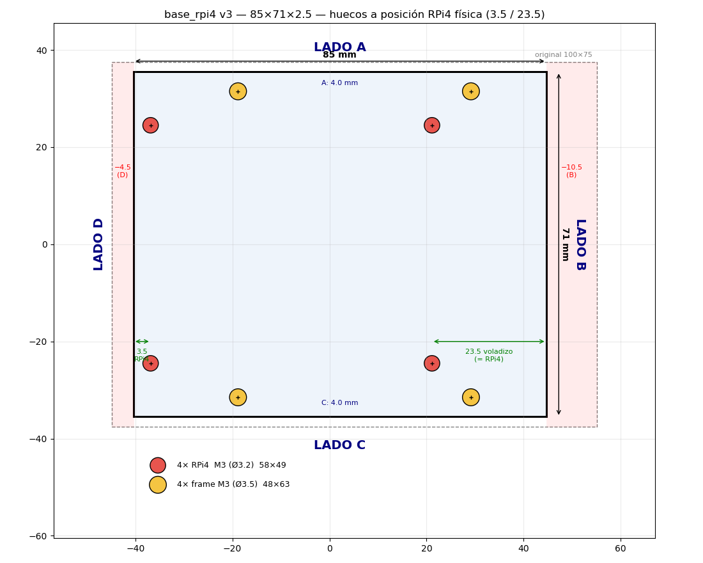

# base_rpi4 — placa base de la Raspberry Pi 4

Placa plana de montaje para la RPi4 del dron. Versión modificada a partir del
STL original de fábrica (`base_rpi4.stl`, 100 × 75 × 2.5 mm).



## Cambios respecto al original

| Parámetro | Original | Esta versión |
|-----------|----------|--------------|
| Tamaño | 100 × 75 mm | **85 × 71 mm** |
| Espesor | 2.5 mm | 2.5 mm (sin cambio) |
| Huecos RPi4 | 4× Ø2.7 | **4× M3 (Ø3.2)** |
| Huecos frame | 4× Ø3.5 (M3) | 4× Ø3.5 (M3) (sin cambio) |

- **85 mm en X** = largo de la placa RPi4 física. Los 4 huecos de montaje
  quedan en su posición real: **3.5 mm desde el lado D** (lado GPIO) y
  **23.5 mm de voladizo en el lado B** (lado USB/ethernet). Así la RPi4 asienta
  igual que en su placa de referencia.
- **71 mm en Y** (−2 mm en los lados A y C respecto al original). Se mantiene
  para conservar los 4 huecos de sujeción al frame (patrón 48 × 63 mm), que
  están a y = ±31.49 y quedarían fuera si se bajara al ancho exacto de 56 mm.

## Agujeros

| Grupo | Ø | Patrón (centro a centro) | Posiciones (x, y) mm |
|-------|-----|--------------------------|----------------------|
| RPi4 (M3) | 3.2 | 58 × 49 | (−36.86, ±24.5), (21.12, ±24.5) |
| Frame (M3) | 3.5 | 48 × 63 | (−18.85, ±31.49), (29.15, ±31.49) |

Lados: **A** = borde superior (Y max), **B** = derecho (X max, voladizo),
**C** = inferior (Y min), **D** = izquierdo (X min, lado GPIO).

## Archivos

- `base_rpi4.stl` — malla final, watertight, 85 × 71 × 2.5 mm, ~14.9 cm³.
- `generate_base_rpi4.py` — generador paramétrico (trimesh + shapely).
- `base_rpi4_plano.png` — plano 2D acotado con los lados A/B/C/D.
- `base_rpi4_render.png` — render 3D.

## Regenerar

```bash
python3 hardware/base_rpi4/generate_base_rpi4.py
```
