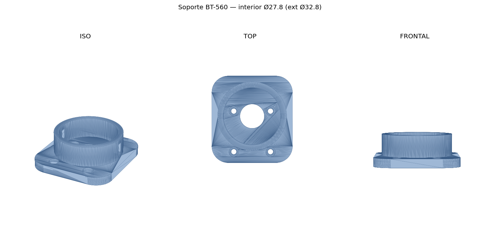
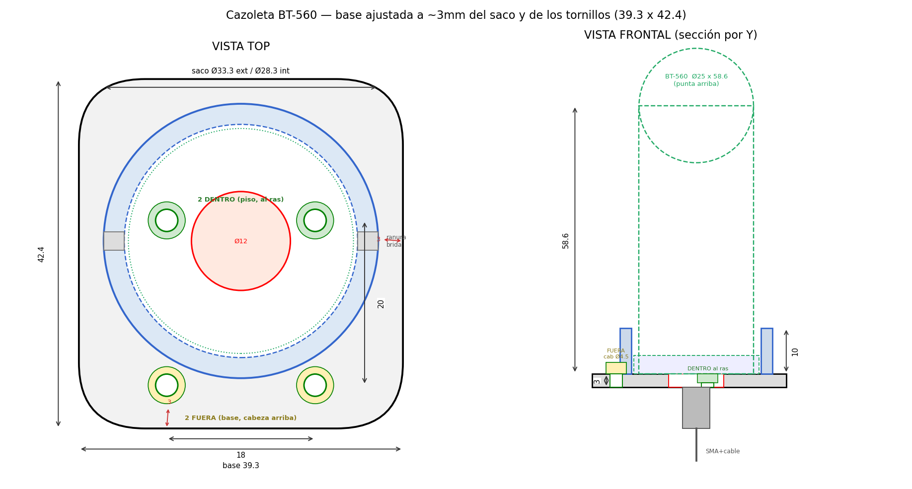

# Soporte "saco" para la antena RTK Beitian BT-560

Cazoleta que sujeta la antena helicoidal BT-560 (Ø27.3 × 58.6, SMA-J hembra axial,
~20 g, helicoidal → sin plano de masa) sobre 4 tornillos del frame del dron.

 

## Cotas (mm)
- Antena: cuerpo Ø25, base Ø27.3, alto 58.6; punta arriba, SMA abajo.
- Saco: **Ø27.8 interior** (holgura ~0.5 mm + brida), Ø32.8 exterior,
  pared 2.5, alto **10**. Desplazado +7.5 respecto al patrón de tornillos.
- Hueco central **Ø12** para el SMA + cable.
- Base rectangular **39.3 × 42.4 × 4**, esquinas R8 (~3 mm al saco y a los tornillos de fuera).
- Tornillos: 4× **M2.5** (pasante Ø2.7), patrón **18 × 20**. **2 dentro** del saco
  (avellanados, se aprietan antes de meter la antena) y **2 fuera** en la base.
- 2 ranuras de brida en la pared del saco.

Los **4 tornillos** llevan **caja cilíndrica de fondo plano (counterbore) Ø4.8 × 2.5**, para
cabeza cilíndrica/pan de Ø4.5 × 2.5. Base de **4 mm** → **1.5 mm de suelo** bajo la cabeza
(agarre al frame = vástago bajo la cabeza − 1.5 mm). Los 2 de dentro se aprietan antes de meter
la antena; los 2 de fuera quedan accesibles en la base.

## Regenerar
`python3 generate_bt560_mount.py` (necesita trimesh + manifold3d + shapely + numpy).
Edita las cotas al principio. Imprimir con la base sobre la cama, PLA/PETG, sin soportes.
