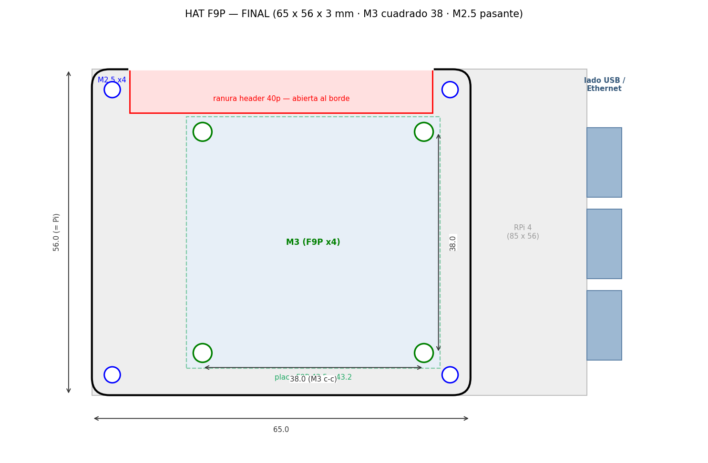

# HAT para el GPS F9P sobre la Raspberry Pi

Placa plana a medida que se monta sobre la RPi (estilo HAT) y sujeta el receptor
**SparkFun GPS-RTK-SMA (ZED-F9P)** en el hueco entre la Pi y la base del LiDAR 360.

## Cotas (mm)
- Placa **65 × 56 × 3**, esquinas R3. A ras de la Pi: **no sobresale** del contorno
  (los separadores del LiDAR suben por las esquinas y no deben chocar).
- **4× M2.5 pasante** (Ø2.75) en el patrón de la RPi (3.5/61.5 × 3.5/52.5) — los
  separadores del LiDAR atraviesan la placa.
- **4× M3** (Ø3.2) en **cuadrado de 38 mm** centro a centro, desplazados hacia el
  **lado USB/Ethernet** de la Pi, para la placa del F9P (43.5 × 43.2, SMA hacia fuera).
- **Ranura del header de 40 pines abierta al borde superior** (sin puente): los
  cables UART Rx/Tx/GND pasan y el resto del GPIO queda libre.
- Holguras: paredes ≥1.1 mm en todos los agujeros.

La brújula (GY-273 / QMC5883L) no va en esta placa; se monta aparte.

## Regenerar
`python3 generate_f9p_hat.py` (necesita trimesh + shapely + matplotlib). Edita las
cotas al principio del script. Genera `f9p_hat.stl` y el plano.

## Imprimir
Plano sobre la cama (cara lisa abajo), PLA/PETG, 3–4 perímetros, 30–40 % relleno,
sin soportes.
